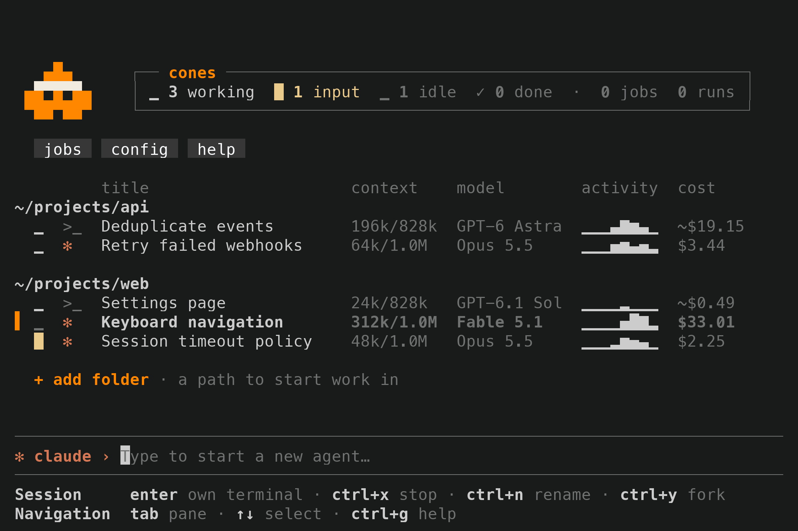
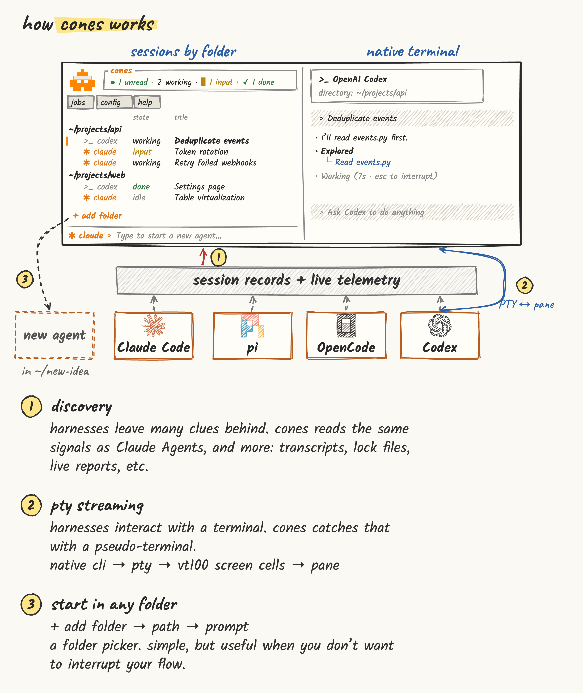

<p align="center">
  
</p>

**A terminal workspace for coding agents.** Browse sessions and history, peek into running work, and start agents across projects. Claude Code, Codex, pi and OpenCode keep their native terminal interfaces. Your agents get the same reach through the `cones` command and its [skill](assets/coordinator/skills/cones/SKILL.md): list, read, start, message and stop sessions in any folder.

<p align="center"><a href="assets/tui.gif"></a><br><sub>Recorded with native CLIs in sample projects. <a href="assets/tui.svg">Still image</a>.</sub></p>

## Install

Requires macOS or Linux and a [configured harness](docs/harness.md).

```sh
brew tap YuvalSarel1/cones https://github.com/YuvalSarel1/cones
brew trust YuvalSarel1/cones
brew install cones
```

On Intel Macs Homebrew builds from source and needs a current Xcode. Or use Cargo: `cargo install --git https://github.com/YuvalSarel1/cones`.

On Linux, install with Cargo; it needs `procps` (`ps`). Jobs run from systemd user timers, notifications use `notify-send`, and the clipboard uses `wl-copy`/`wl-paste` or `xclip`, falling back to the terminal's OSC 52 over ssh.

## Quick start

```sh
cones
```

Existing sessions appear automatically. `Enter` opens one; `Ctrl+Z` returns to the list.

To start work, select `+ add folder` and enter a project directory. Choose a harness with `Shift+Tab`, type an instruction, and press `Enter`.

<p align="center"><a href="assets/architecture.png"></a></p>

[Dashboard](docs/dashboard.md) · [Commands](docs/cli.md) · [Scheduled jobs](docs/jobs.md) · [Harness support](docs/harness.md) · [Architecture](docs/architecture.md) · [Comparisons](docs/comparisons/README.md)
